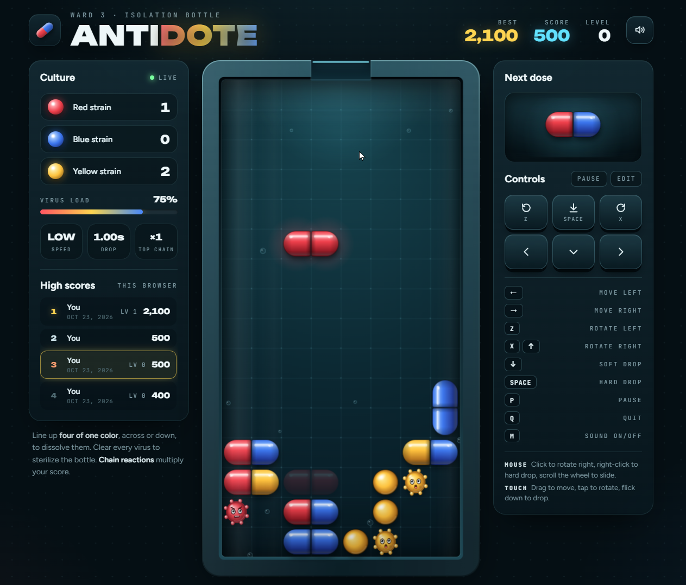

# Antidote

A Dr. Mario–style falling-capsule puzzle game in a single HTML file. You drop two-color capsules into a glass isolation bottle and line up colors to wipe out the viruses growing inside it.

Everything is drawn live in the browser: glossy lit capsules, animated viruses that follow the falling pill with their eyes, particles, screen shake and sound effects made in code. There are no images, audio files, build steps or dependencies.

## Getting started

1. Download `antidote.html`.
2. Open it in a modern browser (Chrome, Edge, Firefox or Safari).
3. Pick a difficulty and a starting level, then press **Start game** or **Enter**.

The page loads three Google Fonts (Unbounded, Figtree, JetBrains Mono). Without an internet connection it still plays, using system fonts.

## How to play

- Capsules fall into the bottle from the opening at the top. Each capsule has two halves, and each half is red, blue or yellow.
- Line up **four or more of the same color**, across or down, to dissolve them. Viruses count toward a line just like capsule halves.
- When half of a capsule is cleared, the other half becomes a single piece and falls. Pieces left hanging by a clear also fall, which can set off **chain reactions**.
- Clear every virus to sterilize the bottle and move on to the next level.
- The game ends when there's no room for a new capsule at the top.
- The opening at the top pulses red when your stack is getting close to it.

### Scoring

| Cleared piece  | Points |
| -------------- | ------ |
| Virus          | 200    |
| Capsule half   | 100    |

Each step of a chain multiplies the points for that step by the chain number: the first clear scores ×1, the clear it triggers ×2, then ×3 and so on.

### Difficulty

Choose a difficulty on the start screen, above the level picker. The game remembers your choice in this browser, and **Lab Technician** is the default for new players.

| Mode | Who it's for | How it climbs |
| ---- | ------------ | ------------- |
| **Lab Assistant** | New players and relaxed runs | 2 more viruses per level. Capsules get about 6% faster each level and never drop faster than 0.25 s per row. |
| **Lab Technician** | Most players | 3 more viruses per level. Capsules get about 10% faster each level and never drop faster than 0.15 s per row. |
| **Chief Virologist** | Experts | The original tuning: 4 more viruses per level, a steep speed curve that reaches its top speed of 0.10 s per row at level 9, and a virus area that only grows every second level, so odd levels are noticeably more crowded. |

In Lab Assistant and Lab Technician the area the viruses grow in gets taller every level, so the bottle fills up steadily instead of jumping on alternate levels. In every mode that area tops out at 12 of the bottle's 16 rows.

### Levels

You can start on any level from 0 to 20, and clearing a bottle moves you to the next level. Higher levels add more viruses, spread them higher up the bottle and drop capsules faster. The drop interval is how long a capsule takes to fall one row; the panel shows it as Low (0.65 s or slower), Med or High (faster than 0.30 s).

| Level | Assistant viruses | Assistant drop | Technician viruses | Technician drop | Virologist viruses | Virologist drop |
| ----: | ----: | ----: | ----: | ----: | ----: | ----: |
| 0 | 4 | 1.00 s | 4 | 1.00 s | 4 | 1.00 s |
| 1 | 6 | 0.94 s | 7 | 0.90 s | 8 | 0.85 s |
| 2 | 8 | 0.88 s | 10 | 0.81 s | 12 | 0.70 s |
| 3 | 10 | 0.83 s | 13 | 0.73 s | 16 | 0.58 s |
| 4 | 12 | 0.78 s | 16 | 0.66 s | 20 | 0.45 s |
| 5 | 14 | 0.73 s | 19 | 0.59 s | 24 | 0.35 s |
| 6 | 16 | 0.69 s | 22 | 0.53 s | 28 | 0.25 s |
| 7 | 18 | 0.65 s | 25 | 0.48 s | 32 | 0.18 s |
| 8 | 20 | 0.61 s | 28 | 0.43 s | 36 | 0.13 s |
| 9 | 22 | 0.57 s | 31 | 0.39 s | 40 | 0.10 s |
| 10 | 24 | 0.54 s | 34 | 0.35 s | 44 | 0.10 s |
| 12 | 28 | 0.48 s | 40 | 0.28 s | 52 | 0.10 s |
| 15 | 34 | 0.40 s | 49 | 0.21 s | 64 | 0.10 s |
| 18 | 40 | 0.33 s | 58 | 0.15 s | 76 | 0.10 s |
| 20 | 44 | 0.29 s | 64 | 0.15 s | 84 | 0.10 s |

Above level 20 the counts keep rising by the same steps. Chief Virologist stops at 84 viruses.

## Controls

### Keyboard (default)

| Action        | Keys       |
| ------------- | ---------- |
| Move left     | ←          |
| Move right    | →          |
| Rotate left   | Z          |
| Rotate right  | X or ↑     |
| Soft drop     | ↓          |
| Hard drop     | Space      |
| Pause         | P          |
| Quit run      | Q          |
| Sound on/off  | M          |

**Esc** pauses and resumes, and **Space** resumes while the game is paused. These two always work and can't be remapped.

### Remapping keys

Click **Edit** in the Controls panel. The game pauses and every action shows two key slots.

- Click a slot, then press the key you want.
- **Esc** cancels and **Backspace** clears the slot.
- If the key was already used by another action, it moves to the new one.
- **Reset** restores the defaults. Click **Done** when you're finished.

Your keys are saved in the browser, and the on-screen buttons and hints update to match them.

### Mouse (on the bottle)

| Action        | Input                     |
| ------------- | ------------------------- |
| Rotate right  | Left click                |
| Rotate left   | Middle click              |
| Hard drop     | Right click               |
| Slide         | Scroll wheel: down moves right, up moves left |

Trackpad scrolling works too.

### Touch

- Drag across the bottle to move the capsule.
- Tap to rotate.
- Flick down to hard drop.

The on-screen pad in the Controls panel also works with a mouse or a finger. Holding the arrow buttons repeats the move.

## Features

- **Fills the screen:** the bottle uses the full height of the window and rescales live when you resize it. On narrow screens and phones the layout stacks into one column.
- **High scores:** a top-10 list with the date, level and difficulty of each run. A small tag (ASST, TECH or CHIEF) shows the difficulty; scores from before difficulty modes existed are tagged CHIEF, since they were played at that tuning. All three modes share one list. A run is posted when the game ends or when you quit with a score above zero. The game-over screen tells you when you've set a new high score or made the board.
- **Sound:** effects for moving, rotating, landing, clears, chains, level clears and game over. Use the speaker button or **M** to mute. Browsers only allow sound after your first click or key press.
- **Pause screen:** a blurred overlay with a Resume button.
- **Side panels:** virus counts for each color, a bar showing how much of the infection is left, the current speed, your top chain and a preview of the next capsule.
- **Animated backdrop:** faint cells in the strain colors drift slowly behind the page, like a view down a microscope. It's CSS only and very light on the CPU.
- **Reduced motion:** if your system asks for reduced motion, screen shake, wobble and confetti are toned down, and the background cells stay still.

## Saved data

Everything is stored in your browser's `localStorage`, so it stays on the device and browser you play in. Clearing your site data resets it.

| Key               | Contents                                      |
| ----------------- | --------------------------------------------- |
| `antidote-scores` | Top-10 high scores                            |
| `antidote-keys`   | Your key bindings                             |
| `antidote-muted`  | Whether sound is muted                        |
| `antidote-mode`   | Your chosen difficulty (`assistant`, `technician` or `chief`) |
| `viral-load-best` | Best score from an earlier version. It's carried into the high scores the first time the list is empty. |

## Under the hood

- **One file:** the HTML, CSS and JavaScript all live in `antidote.html`.
- **Graphics:** everything is drawn with the Canvas 2D API at your screen's full pixel density. Capsule halves and virus bodies are pre-rendered as sprites with their own lighting and shadows, and they're rebuilt whenever the board size changes.
- **Animation:** one `requestAnimationFrame` loop handles drawing, effects and the drop timer. Falling and settling pieces are smoothed between grid cells.
- **Sound:** every effect is generated with the Web Audio API from oscillators and filtered noise, running through a compressor.

### Tweaking the game

These constants near the top of the script are the easiest places to start:

| What                  | Where in the script                          |
| --------------------- | -------------------------------------------- |
| Bottle size           | `COLS` and `ROWS`                            |
| Colors                | `PAL`                                        |
| Difficulty modes: virus count, virus area height and drop speed per level | `MODES` |
| Virus placement       | `placeViruses()`                             |
| Scoring               | `countScore()`                               |
| Default keys          | `DEFAULT_KEYS`                               |
| Sound effects         | the `SOUNDS` object inside `Sfx`             |
